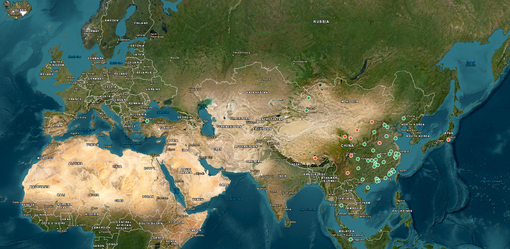

# About me

**Hi there,**

HNU ~~在读本科生~~ 2025届校友 ➡️ HWer（base 东莞）

信仰是 _**Living for fun**,_（高难度 || 未尝试）的事都很有趣

“生活艺术家是真正的艺术家”

**Content about this website,**

* 技术折腾
* 生活感悟
* 论文笔记

**Welcome to contact me,**

* [Github](https://github.com/955xiaoSu)，记录自己写的一些小玩意儿
* 下方是旅游足迹，若有足迹之外的有趣 city 推荐，欢迎邮件联系呀：[kaisuping@gmail.com](mailto:kaisuping@gmail.com)

<figure><figcaption></figcaption></figure>
